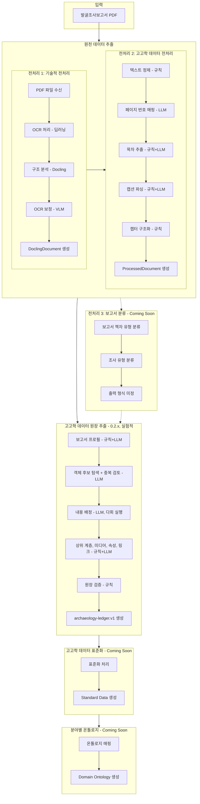
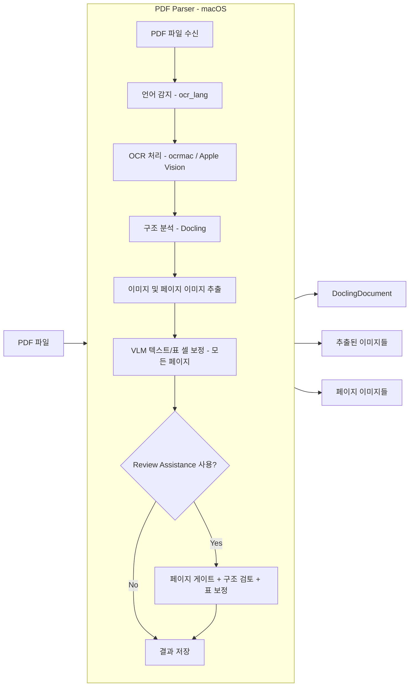
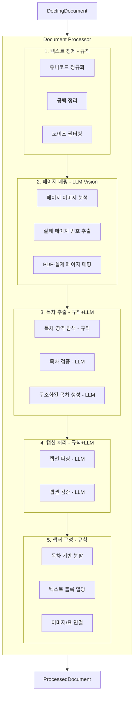
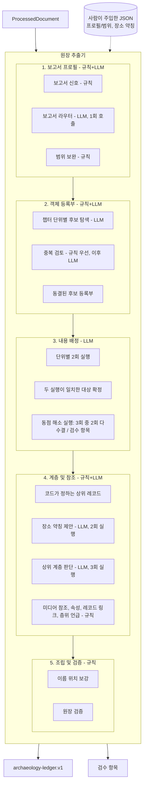
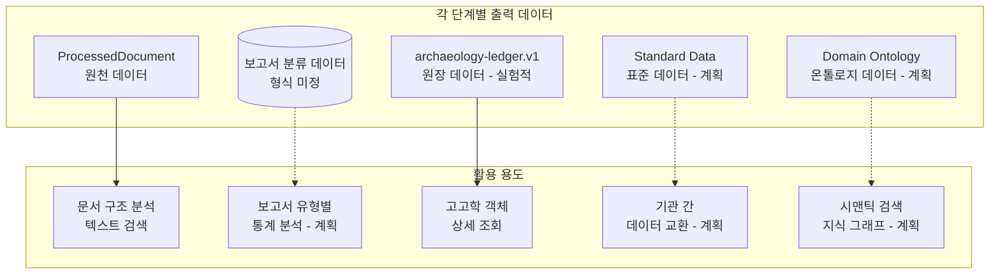

# heripo engine 아키텍처

## 프로젝트 개요

heripo engine은 **고고학 발굴조사보고서**(PDF)에서 데이터를 추출하여 구조화된 데이터베이스로 변환하는 시스템입니다.

### 왜 이 프로젝트가 필요한가?

고고학 발굴조사보고서는 수백~수천 페이지에 달하는 PDF 문서로, 다음과 같은 정보를 포함합니다:

- 발굴 현장의 층위(지층) 정보
- 발견된 유구(건물터, 무덤 등) 상세
- 출토 유물(토기, 석기 등) 목록
- 발굴 과정 사진 및 도면

이러한 정보를 수작업으로 데이터베이스에 입력하는 것은 시간과 비용이 많이 소요됩니다. heripo engine은 이 과정을 **자동화**하여 연구자들이 데이터를 빠르게 활용할 수 있도록 돕습니다.

---

## 전체 처리 흐름



---

## AI 기술 활용 구분

heripo engine은 두 가지 유형의 AI 기술을 활용합니다:

| 구분       | 기술                         | 사용 단계           | 특징                                          |
| ---------- | ---------------------------- | ------------------- | --------------------------------------------- |
| **딥러닝** | Apple Vision Framework (OCR) | 전처리 1            | 이미지에서 텍스트 인식, 로컬 처리, 비용 없음  |
| **VLM**    | GPT, Gemini 등 (Vision)      | 전처리 1            | 모든 페이지의 OCR 텍스트/표 셀 보정, API 호출 |
| **LLM**    | GPT, Claude, Qwen 등         | 전처리 2, 원장 추출 | 텍스트 이해/분석, API 호출, 토큰당 비용 발생  |

### LLM 모델 선택 전략

LLM 비용을 최적화하기 위해 작업 특성에 따라 모델을 구분하여 사용합니다:

| 모델 유형              | 사용 조건                          | 예시                    |
| ---------------------- | ---------------------------------- | ----------------------- |
| **프론티어 상용 모델** | 컨텍스트가 많거나 높은 정확도 필요 | GPT-5.2, Claude Opus 등 |
| **오픈소스 모델**      | 단순 작업, 비용 효율 중시          | Qwen, DeepSeek 등       |

### LLM 검증 및 보정 체계

모든 LLM 처리 과정에는 **프론티어 상용 모델을 활용한 검증/보정 단계**가 포함됩니다:


이 체계를 통해:

- **비용 절감**: 대부분의 처리는 저비용 오픈소스 모델로 수행
- **정확도 보장**: 프론티어 모델이 결과를 검증하여 품질 확보
- **자동 보정**: 검증 실패 시 프론티어 모델이 직접 재처리

원장 추출 단계(0.2.x)는 다른 규칙을 따릅니다. 모델 출력은 코드가 검사하되 절대 고치지 않습니다. 보정 모델 대신 같은 판단을 여러 번 실행해 일치하는 결과만 받아들이고(내용 배정은 두 실행이 함께 반환한 판단, 또는 동점 해소 실행 뒤 세 실행 중 둘이 같은 판단; 상위 계층 판단은 세 실행이 모두 같은 판단), 해결되지 않은 판단은 모두 사람이 결정할 검수 항목이 됩니다.

---

## 단계별 상세 설명

### 입력: 발굴조사보고서

- **형식**: PDF 파일
- **특징**:
  - 스캔된 이미지 기반 (OCR 필요)
  - 수백~수천 페이지 분량
  - 표, 사진, 도면 다수 포함
  - 한국어 텍스트 중심

---

### 전처리 1: 기술적 전처리 (`@heripo/pdf-parser`)

> **현재 구현 완료** ✅

PDF 파일을 컴퓨터가 이해할 수 있는 구조화된 데이터로 변환하는 **기술적 전처리** 단계입니다.

#### 핵심 기술: Docling

[Docling](https://github.com/DS4SD/docling)은 IBM에서 개발한 오픈소스 문서 파싱 라이브러리입니다. PDF, DOCX 등 다양한 문서 형식을 구조화된 데이터로 변환합니다.

#### 플랫폼: macOS 전용 설계

전처리 1은 **성능**(결과물 품질)과 **비용**(머신 비용, 전기료)을 고려하여 macOS 전용으로 설계되었습니다.

- **OCR 엔진**: Apple Vision Framework (딥러닝 기반)
  - macOS에 내장된 고성능 OCR
  - 한국어 인식 품질 우수
  - 추가 비용 없이 로컬에서 처리
- **권장 하드웨어**: Mac mini (M 시리즈)
  - 100만원 미만의 저렴한 비용으로 고성능 처리 가능
  - 전력 소비 낮음 (서버 운영 비용 절감)



#### 주요 기능

| 기능                  | 설명                                                              | AI 기술               |
| --------------------- | ----------------------------------------------------------------- | --------------------- |
| **OCR 처리**          | 스캔된 이미지에서 텍스트 추출 (한국어/영어)                       | 딥러닝 (Apple Vision) |
| **언어 감지**         | 로컬 텍스트 레이어로 OCR 언어 결정, 필요 시 선택적 비전 모델 사용 | VLM (선택)            |
| **VLM 텍스트 보정**   | 모든 페이지에 필수로 적용하는 페이지 단위 OCR 텍스트/표 셀 보정   | VLM (Vision LLM)      |
| **Review Assistance** | 감사 보고서를 남기는 선택적 페이지 게이트, 구조 검토, 표 보정     | VLM (Vision LLM)      |
| **문서 유형 검증**    | 고고학 보고서인지 선택적으로 검증                                 | LLM                   |
| **구조 분석**         | 텍스트, 표, 이미지 영역 자동 식별                                 | Docling (규칙 + ML)   |
| **청크 변환**         | 대용량 PDF를 청크 단위로 분할하여 안정적 처리                     | -                     |
| **이미지 PDF 폴백**   | 직접 변환 실패 시 PDF를 이미지로 변환 후 처리                     | -                     |
| **이미지 추출**       | 문서 내 모든 이미지 파일로 저장                                   | -                     |
| **페이지 이미지**     | 각 페이지를 이미지로 저장 (LLM Vision용)                          | -                     |
| **서버 크래시 복구**  | 연결 실패 시 docling-serve 자동 재시작                            | -                     |

#### OCR 및 보정 파이프라인

파서는 더 이상 OCR 전략을 선택하지 않습니다. **ocrmac(Apple Vision Framework)은 대량 처리에 매우 우수하므로**(무료, GPU 가속, 고품질) Docling 변환은 항상 ocrmac을 사용합니다. **다만 한국어 고고학 보고서에는 OCR만으로 안정적으로 처리하기 어려운 한자 복원과 문자 체계 인식 보정이 자주 필요하므로**, 문서 언어와 관계없이 변환 후 항상 VLM 보정 단계를 실행합니다:

1. **언어 감지** (OCR 언어 결정용) — 명시한 `ocr_lang`이 우선합니다. 그렇지 않으면 로컬 PDF 텍스트 레이어를 검사하고, 필요할 때 선택적 비전 모델을 사용합니다. 원격 입력이나 감지되지 않은 입력은 `ko-KR`, `en-US`를 사용합니다. 이 단계는 OCR 엔진을 고르지 않습니다.
2. **Docling 변환** — ocrmac OCR과 구조 분석을 수행하고, 보정 전에 `result_ocr_origin.json`을 저장합니다.
3. **필수 텍스트/표 셀 보정** — 텍스트나 표가 있는 모든 페이지를 VLM 텍스트/표 셀 보정에 보냅니다.
4. **Review Assistance** (기본 사용, 끌 수 있음) — 페이지 게이트가 가치가 낮은 페이지를 건너뛰고, 구조 검토와 표 전용 보정이 감사용 제안을 기록하며 신뢰도 높은 수정은 자동 적용합니다.

세 보정 모델(`textCorrection`, `pageGate`, `reviewAssistance`)은 구조 검토를 끈 경우에도 모든 `parse()` 호출에 필요합니다. 실패한 보정 호출은 원래 OCR 텍스트를 유지하고 경고를 남깁니다.

#### 출력물: DoclingDocument

```
DoclingDocument
├── texts[]          # 추출된 모든 텍스트
├── tables[]         # 추출된 모든 표
├── pictures[]       # 추출된 모든 이미지 정보
└── pages{}          # 페이지별 정보
```

---

### 전처리 2: 고고학 데이터 전처리 (`@heripo/document-processor`)

> **현재 구현 완료** ✅

추출된 원시 데이터를 **고고학 데이터 구축에 최적화된 형태**로 정제하고 구조화하는 단계입니다. 원장 추출이 효율적으로 작동할 수 있도록 문서를 챕터 단위로 분리하고, 이미지/표와의 관계를 정립합니다.

#### 설계 철학: 극단적 비용 효율 + 자기 검증

전처리 2는 다음 두 가지 원칙으로 설계되었습니다:

1. **극단적인 비용 효율**
   - 작업별로 최적의 LLM 모델 선택 (고성능 vs 저비용)
   - 규칙 기반 처리 우선, LLM은 필요한 곳에만 사용
   - 배치 처리로 API 호출 횟수 최소화

2. **자기 검증 설계**
   - 모든 LLM 출력에 대해 검증 단계 포함
   - 검증 실패 시 자동 재처리 또는 폴백
   - 정확도와 비용 동시 최적화

**결과**: 두꺼운 보고서(수천 페이지) 기준 **500원 미만**, 얇은 보고서는 **100원 미만**의 처리 비용 달성



#### 처리 방식별 구분

| 단계        | 컴포넌트               | 규칙 기반         | LLM            | 자기 검증              |
| ----------- | ---------------------- | ----------------- | -------------- | ---------------------- |
| 페이지 매핑 | **PageRangeParser**    | -                 | ✅ Vision      | -                      |
| 목차 추출   | **TocFinder**          | ✅ 목차 영역 탐색 | -              | -                      |
| 목차 추출   | **TocExtractor**       | -                 | ✅ 구조화      | ✅ TocContentValidator |
| 목차 추출   | **VisionTocExtractor** | -                 | ✅ Vision 폴백 | ✅ TocContentValidator |
| 캡션 처리   | **CaptionParser**      | ✅ 패턴 매칭      | ✅ 복잡한 캡션 | ✅ CaptionValidator    |
| 챕터 구성   | **ChapterConverter**   | ✅ 목차 기반 분할 | -              | -                      |

#### 출력물: ProcessedDocument

```
ProcessedDocument
├── reportId           # 보고서 고유 ID
├── pageRangeMap       # PDF 페이지 → 실제 페이지 매핑 (Record<number, PageRange>)
├── chapters[]         # 목차 기반 챕터 구조
│   ├── originTitle    # 보고서 원본 제목
│   ├── title          # 정리된 챕터 제목
│   ├── textBlocks[]   # 챕터 내 텍스트들
│   ├── imageIds[]     # 연결된 이미지 ID들
│   ├── tableIds[]     # 연결된 표 ID들
│   ├── footnoteIds[]  # 연결된 각주 ID들
│   └── children[]     # 하위 챕터들
├── images[]           # 이미지 정보 (캡션, 위치 등)
├── tables[]           # 표 정보 (캡션, 셀 데이터 등)
└── footnotes[]        # 각주 정보 (텍스트, 페이지 번호)
```

---

### 전처리 3: 보고서 분류

> **Coming Soon** 🔒

원장 추출을 원활하게 하기 위해 보고서의 유형을 세부적으로 분류하는 단계입니다.

#### 분류 대상 (예시)

| 분류 항목     | 설명                      | 예시                                   |
| ------------- | ------------------------- | -------------------------------------- |
| **책자 유형** | 보고서의 물리적 구성 형태 | 본문+도판, 본문만, 종합보고서          |
| **조사 유형** | 발굴조사의 종류           | 발굴조사, 시굴조사, 지표조사           |
| **시대 분류** | 주요 출토 유물의 시대     | 선사시대, 삼국시대, 고려시대, 조선시대 |
| **유적 성격** | 발굴된 유적의 주요 성격   | 생활유적, 분묘유적, 생산유적, 관방유적 |

#### 출력 데이터

보고서 분류의 출력 형식은 아직 확정되지 않았습니다. 고고학 데이터 원장의 메타데이터로 포함될 예정입니다.

> 원장 단계(0.2.x)에는 이미 더 좁은 범위의 **보고서 프로필**이 포함되어 있습니다. 원장 추출 경로를 정하는 특성 판정과 조사 범위입니다(아래 참고). 여기서 설명하는 책자/조사/시대 분류와는 다릅니다.

---

### 고고학 데이터 원장 추출 (`@heripo/ledger-extractor`)

> **첫 릴리스 (0.2.x), 실험적** 🧪

`ProcessedDocument`에서 조사 객체(유적, 구역, 트렌치, 층위, 유구, 유물 등)를 추출하여 실험적 형식 `archaeology-ledger.v1`의 **원장**을 조립합니다. 형식, 검수 항목, 프롬프트는 0.2.x 릴리스 안에서 마이그레이션 없이 바뀔 수 있으므로, 원본 전처리 문서를 보관하고 업그레이드 후 원장을 다시 만들어야 합니다. 이 단계는 보고서 세 권(『태안 마도 해역 수중발굴조사』, 『부여 화지산 백제과원 및 둘레길 조성사업부지내 유적』, 『거제 사등성 하수관로 매설구간 내 유적 발굴조사』)으로만 개발·측정되었으므로, 다른 보고서 유형과 레이아웃에서는 빈틈이 있을 수 있습니다.

#### 설계 원칙

- **원문 충실성**: 레코드는 원문 텍스트(문장, 표 구절, 이름)와 출처 참조(리소스 키, 문자 범위, PDF 페이지, 챕터, `sourceRef`)를 보존합니다. 정규화나 변환은 하지 않습니다.
- **모델 출력 무보정**: 코드는 모든 모델 응답을 입력과 대조해 검사하며, 잘못된 응답은 조용히 고친 값이 아니라 이슈로 남깁니다.
- **보정 대신 일치**: 내용 배정은 단위마다 두 번 실행해 두 실행이 함께 반환한 대상을 확정하고, 갈린 곳은 세 번째 실행으로 세 실행 중 둘이 같은 쪽(`model_majority`)을 확정하며, 그래도 정해지지 않은 것은 검수로 보냅니다. 상위 계층 판단은 세 번 실행해 모두 같을 때만 부모를 정합니다.
- **해결되지 않은 판단은 사람이 결정**: 불확실한 동일성, 다툼이 있는 배정, 열린 상위 계층, 모호한 미디어와 속성 소유자는 검수 항목이 됩니다. 사람이 보고서 프로필/범위나 장소 약칭 표를 JSON으로 주입할 수도 있습니다.
- **결정론적 조립**: 모델 단계는 결과를 저장하고, `buildArchaeologyLedger`는 모델 호출 없이 그 결과로 원장을 조립하고 검증하므로 같은 입력은 항상 같은 원장을 만듭니다.
- **지출 절대 상한**: 상한을 지정하면 `createSpendGuard`(`@heripo/shared`에서 재노출)가 호출마다 최대 사용량을 미리 예약하여, 실행이 호출 수나 토큰 상한을 넘기 전에 멈춥니다. 데모의 CLI 배치 실행기는 기본으로 보고서별 상한(호출 600회, 토큰 1,300만 개)을 설정하며, 데모 웹 작업은 상한 없이 실행됩니다.

#### 비용 전망

- **목표**: 두꺼운 보고서 기준 전처리 + 원장 추출 합계 **2,000원 미만**
- **실측 (보고서 1건)**: 태안 마도 보고서에서 Claude Haiku 5.5(데모 기본값)로 원장 실행당 약 **0.33달러(US$)**, 검수 항목 약 15개. 다른 보고서의 비용은 아직 체계적으로 측정하지 않았습니다.



패키지는 각 단계를 함수로 제공하며, 데모 웹 앱(`apps/demo-web/src/lib/ledger/ledger-pipeline.ts`)이 이를 사람의 개입 없는 한 번의 실행으로 연결합니다.

#### 처리 방식별 구분

| 단계          | 컴포넌트 / 함수                                              | 규칙 기반                           | LLM                                      | 모델 출력 처리                                       |
| ------------- | ------------------------------------------------------------ | ----------------------------------- | ---------------------------------------- | ---------------------------------------------------- |
| 원문 조회     | `buildDocumentResourceIndex`                                 | ✅ 문서 전체 리소스 색인            | -                                        | -                                                    |
| 보고서 프로필 | `collectReportSignals`, `routeReport`, `completeReportScope` | ✅ 신호, 범위 보완                  | ✅ 라우터 (1회 호출)                     | 문제없는 고신뢰 특성만 유지, 나머지는 `unclear`      |
| 후보 탐색     | `prepareCandidateDiscovery`, `discoverCandidateUnit`         | ✅ 단위 계획                        | ✅ 챕터 단위별                           | 검사만 하고 고치지 않음, 선택적 재시도               |
| 중복 검토     | `planCandidateDeduplication`, `deduplicateCandidateBlocks`   | ✅ 같은 식별자/이름 병합            | ✅ 남은 후보를 블록 단위로               | 불확실한 동일성 → 검수 항목                          |
| 등록부 동결   | `prepareContentAttachment`                                   | ✅ 동결된 등록부와 배정 계획        | -                                        | -                                                    |
| 내용 배정     | `attachContentThinUnit`                                      | ✅ 행 소유, 후보 사전 필터, 라우팅  | ✅ 단위별 2회 실행, 동점 해소 실행       | 일치 또는 3회 중 2회 다수결 대상 확정, 나머지 → 검수 |
| 상위 계층     | `resolveRelationParents`, `judgeRelationParentBatch`         | ✅ 출토 위치 표현, 소속 열          | ✅ 3회 실행 판단                         | 모든 실행이 일치할 때만 확정, 그 외 → 검수           |
| 장소 약칭     | `validatePlaceAliases`, `proposePlaceAliases`                | ✅ 사람 또는 모델 표 검증           | ✅ 2회 실행 제안 (사람의 표가 없을 때만) | 두 실행이 똑같이 내고 검사를 통과한 규칙만           |
| 미디어 참조   | `indexMediaCaptions`, `applyLedgerMedia`                     | ✅ 캡션 라벨, 본문·캡션 참조        | -                                        | -                                                    |
| 속성          | `collectTableAttributes`, `collectTextAttributes`            | ✅ 표 행과 측정값, 적힌 그대로 보존 | -                                        | -                                                    |
| 레코드 링크   | `collectRelationSentences`, `resolveRecordLinks`             | ✅ 관계 단서와 관계 열              | -                                        | -                                                    |
| 조립 및 검증  | `buildArchaeologyLedger`, `validateArchaeologyLedger`        | ✅ 결정론적 조립, 출처/충실성 검사  | -                                        | -                                                    |

#### 추출 대상 데이터

레코드는 여덟 종류로 등록됩니다:

| 종류       | 설명                           | 예시                  |
| ---------- | ------------------------------ | --------------------- |
| **유적**   | 유적 또는 조사 전체            | 발굴 유적             |
| **구역**   | 조사 또는 발굴 구역            | 번호가 붙은 조사 구역 |
| **트렌치** | 트렌치 또는 시굴갱             | 1트렌치               |
| **층위**   | 보고서에 명시된 층위 단위      | 표토층, 문화층        |
| **유구**   | 발굴된 구조물과 흔적           | 주거지, 수혈, 무덤    |
| **유물**   | 발견된 물건들                  | 토기, 석기, 철기      |
| **난파선** | 수중조사의 난파선              | 침몰선                |
| **미상**   | 원문이 종류를 밝히지 않은 객체 | -                     |

각 레코드는 내용 발췌와 출처를 가지며, 찾은 경우 상위 레코드, 속성, 도면·사진 참조, 다른 레코드와의 링크를 가집니다. 층위 언급은 관계 후보로 보존되며, 더 완전한 관계 추출은 아직 계획 단계입니다.

---

### 고고학 데이터 표준화

> **Coming Soon** 🔒

원장 데이터를 표준화된 형식으로 변환합니다. 다양한 보고서에서 추출된 데이터를 통일된 스키마로 정규화합니다.

---

### 분야별 온톨로지

> **Coming Soon** 🔒

표준 데이터에 분야별 온톨로지를 적용하여 도메인 특화 데이터를 생성합니다.

---

### 데이터 구조 및 저장 전략

#### 파이프라인별 독립 데이터

각 파이프라인 단계에서 생성되는 데이터는 **독립적으로 관리**되며, **활용 용도가 다릅니다**. 추출 순서만 의존적일 뿐, 각 데이터는 별도로 저장하고 활용할 수 있습니다.



#### 데이터 저장 방식 (미정)

heripo engine의 데이터 저장 방식은 아직 결정되지 않았습니다:

| 옵션       | 설명                   | 장점                                | 단점                         |
| ---------- | ---------------------- | ----------------------------------- | ---------------------------- |
| **옵션 A** | TypeScript 모델만 제공 | 유연성, 기존 시스템 통합 용이       | 사용자가 직접 저장 구현 필요 |
| **옵션 B** | PostgreSQL 풀세트 제공 | 즉시 사용 가능, 각 단계에 저장 통합 | 특정 DB에 종속               |

**옵션 B 선택 시**, 데이터베이스 저장은 별도 마지막 단계가 아닌 **각 파이프라인 단계에 통합**됩니다.

#### 확장 가능한 저장소 구조

향후 데이터 활용 방식에 따라 다양한 저장소로 확장할 수 있습니다:

| 저장소           | 용도                                 | 상태    |
| ---------------- | ------------------------------------ | ------- |
| **RDBMS**        | 기본 스키마로 구조화된 데이터 저장   | 📋 예정 |
| **Graph DB**     | 온톨로지 기반 관계 탐색, 지식 그래프 | 📋 예정 |
| **Vector Store** | 시맨틱 검색, 유사도 기반 탐색        | 📋 예정 |

#### 온톨로지 기반 스키마 확장

기본 스키마 구축 이후, **특정 시대/분야별 온톨로지 연구 성과**를 활용하여 스키마를 확장합니다:

| 분야       | 온톨로지 적용 예시                       |
| ---------- | ---------------------------------------- |
| **신석기** | 토기 형식 분류 체계, 석기 제작 기법 관계 |
| **고분**   | 묘제 유형 계층, 부장품 배치 패턴         |
| **고선박** | 선박 구조 용어 체계, 목재 수종 관계      |

온톨로지 확장을 통해 다음이 가능해집니다:

- **시맨틱 탐색**: "삼국시대 주거지에서 출토된 회청색 경질토기" 같은 의미 기반 검색
- **관계 추론**: 유물-유구-시대 간의 복잡한 관계 탐색
- **지식 그래프**: 고고학 데이터 간의 연결망 시각화

---

## 기술 스택

### 핵심 기술

| 기술                       | 용도                            | 단계                  |
| -------------------------- | ------------------------------- | --------------------- |
| **TypeScript**             | 전체 시스템 개발 언어           | 전체                  |
| **Docling**                | PDF 파싱 (오픈소스)             | 전처리 1              |
| **Apple Vision Framework** | OCR (딥러닝)                    | 전처리 1              |
| **AI SDK (Vercel)**        | LLM 연동 (OpenAI, Anthropic 등) | 전처리 1~2, 원장 추출 |
| **Zod**                    | 구조화 출력 및 입력 검증        | 전처리 1~2, 원장 추출 |
| **pnpm**                   | 모노레포 패키지 관리            | 전체                  |
| **Turbo**                  | 빌드 시스템                     | 전체                  |

### 패키지 구조

```
heripo-engine/
├── apps/
│   └── demo-web/             # 웹 데모 애플리케이션
├── packages/
│   ├── pdf-parser/           # 전처리 1: 기술적 전처리
│   ├── document-processor/   # 전처리 2: 고고학 데이터 전처리
│   ├── ledger-extractor/     # 고고학 데이터 원장 추출 (0.2.x, 실험적)
│   ├── model/                # 데이터 모델 정의
│   ├── logger/               # 로거 인터페이스 및 어댑터
│   └── shared/               # 공유 유틸리티 (LLM 호출기, 지출 가드 등)
└── tools/
    ├── tsconfig/             # 공유 TypeScript 설정
    ├── tsup-config/          # 공유 tsup 설정
    └── vitest-config/        # 공유 Vitest 설정
```

### Demo Web Application (`demo-web`)

PDF 처리와 원장 추출 파이프라인을 시각화하고 테스트할 수 있는 Next.js 16 기반 웹 애플리케이션입니다.

**주요 기능:**

- PDF 업로드 및 처리 옵션 설정 (OCR 언어, LLM 모델 선택)
- 실시간 처리 진행 상황 모니터링 (SSE 스트리밍)
- 처리 결과 시각화 (챕터 트리, 이미지/표 뷰어, 페이지 뷰어)
- 토큰 사용량 분석 및 비용 계산
- 결과 다운로드 (ZIP, JSON)
- `processed-document.json` 업로드나 전처리 결과로 고고학 원장 실행, 단계별 모델 선택 (기본 Claude Haiku 5.5, LM Studio를 통한 로컬 모델도 가능)
- 여러 문서에 원장 실행을 돌리는 CLI 배치 실행기 (`pnpm --filter @heripo/demo-web ledger:batch`), 호출 수와 토큰에 절대 상한 적용, Anthropic 모델은 기본적으로 Anthropic Message Batches API 사용

**기술 스택:**

- Next.js 16 (App Router)
- React Query (서버 상태 관리)
- shadcn/ui + Tailwind CSS

---

## 처리 비용 요약

| 파이프라인 단계                 | AI 유형                            | 비용                                   | 비고                                                                               |
| ------------------------------- | ---------------------------------- | -------------------------------------- | ---------------------------------------------------------------------------------- |
| **원천 데이터 추출 (전처리 1)** | 딥러닝 (Apple Vision)              | **무료**(OCR) + VLM 보정 비용          | Apple Vision OCR은 로컬 처리; 필수 VLM 보정 비용은 모델과 페이지 수에 따라 달라짐  |
| **원천 데이터 추출 (전처리 2)** | LLM (GPT, Claude 등)               | **100~500원**                          | 얇은 보고서 100원 미만, 두꺼운 보고서 500원 미만                                   |
| **전처리 3: 보고서 분류**       | LLM (예상)                         | **미정**                               | Coming Soon                                                                        |
| **고고학 데이터 원장 추출**     | LLM (기본 Claude Haiku 5.5) + 규칙 | **약 0.33달러(US$)** (보고서 1건 실측) | 0.2.x, 실험적; 태안 마도 보고서, 검수 항목 약 15개; 보고서 유형별 측정은 아직 없음 |
| **고고학 데이터 표준화**        | 규칙 기반 (예상)                   | **무료** (예상)                        | Coming Soon                                                                        |
| **분야별 온톨로지**             | LLM/규칙 혼합 (예상)               | **미정**                               | Coming Soon                                                                        |

### 비용 절감 전략

- **작업별 최적 모델 선택**: 단순 작업은 저비용 모델, 복잡한 분석은 고성능 모델
- **규칙 기반 처리 우선**: LLM 호출 전 규칙으로 처리 가능한 부분 먼저 처리
- **배치 처리**: 여러 요청을 묶어서 API 호출 횟수 최소화
- **자기 검증**: 실패한 항목만 재처리하여 불필요한 비용 방지
- **지출 절대 상한**: 상한을 지정하면 원장 단계의 지출 가드가 호출마다 최대 사용량을 미리 예약하므로, 실행은 호출 수나 토큰 상한을 넘기 전에 멈춤 (CLI 배치 실행기는 기본으로 보고서별 상한을 설정하며, 데모 웹 작업은 상한 없이 실행)
- **배치 API**: 데모는 Anthropic 원장 호출을 기본적으로 Message Batches API로 전송

---

## 개발 현황

| 파이프라인 단계             | 출력 데이터                    | 상태                 | 설명                                                                      |
| --------------------------- | ------------------------------ | -------------------- | ------------------------------------------------------------------------- |
| 원천 데이터 추출 (전처리 1) | DoclingDocument                | ✅ 완료              | PDF → 구조화된 문서                                                       |
| 원천 데이터 추출 (전처리 2) | ProcessedDocument              | ✅ 완료              | DoclingDocument → 챕터 구조화                                             |
| 전처리 3: 보고서 분류       | (형식 미정)                    | 🔒 Coming Soon       | 보고서/조사 유형 분류                                                     |
| 고고학 데이터 원장 추출     | archaeology-ledger.v1 (실험적) | 🚧 첫 릴리스 (0.2.x) | ProcessedDocument → 출처가 붙은 원장과 검수 항목; 보고서 세 권으로만 검증 |
| 고고학 데이터 표준화        | Standard Data (계획)           | 🔒 Coming Soon       | 표준 스키마 변환                                                          |
| 분야별 온톨로지             | Domain Ontology (계획)         | 🔒 Coming Soon       | 분야별 온톨로지 적용                                                      |
