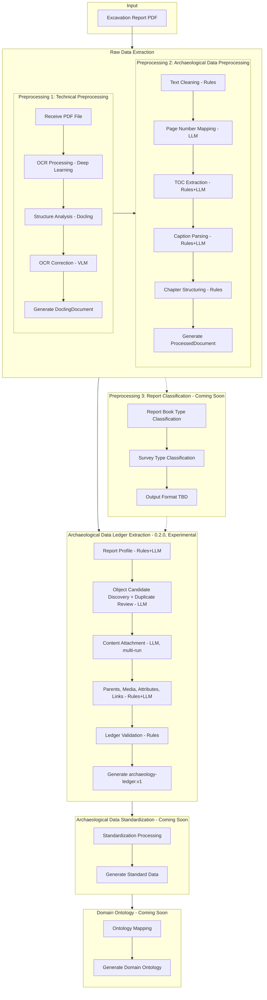
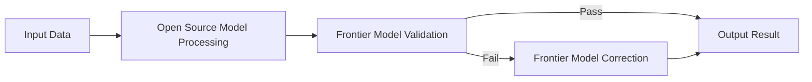
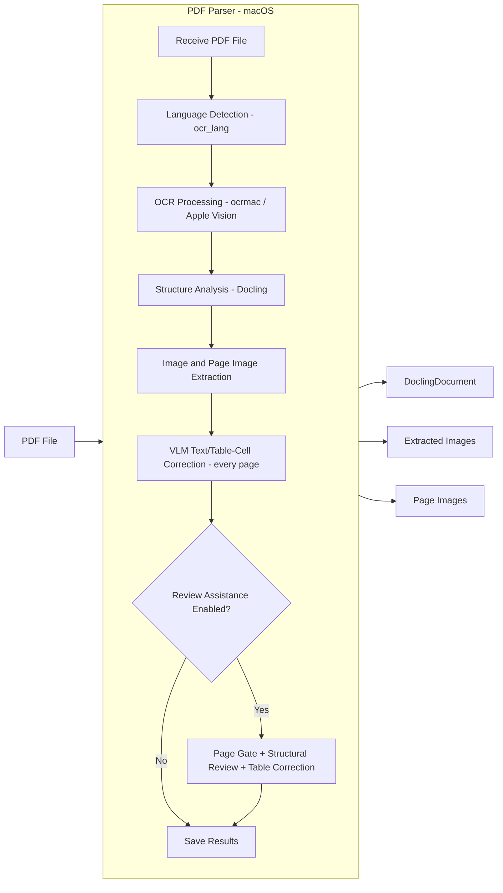
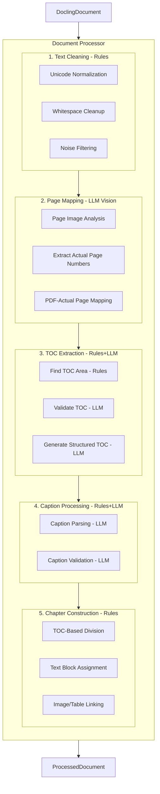
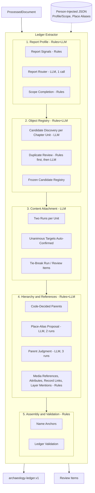
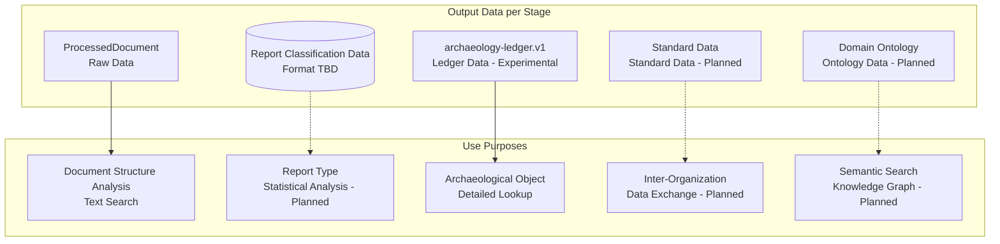

# heripo engine Architecture

## Project Overview

heripo engine is a system that extracts data from **archaeological excavation reports** (PDFs) and transforms them into structured databases.

### Why is This Project Needed?

Archaeological excavation reports are PDF documents spanning hundreds to thousands of pages, containing information such as:

- Stratigraphy information from excavation sites
- Details of discovered features (building sites, tombs, etc.)
- Lists of artifacts (pottery, stone tools, etc.)
- Photographs and diagrams of the excavation process

Manually entering such information into databases is time-consuming and expensive. heripo engine **automates** this process, enabling researchers to quickly utilize the data.

---

## Overall Processing Flow



---

## AI Technology Usage

heripo engine utilizes two types of AI technology:

| Type              | Technology                   | Stage                              | Characteristics                                                    |
| ----------------- | ---------------------------- | ---------------------------------- | ------------------------------------------------------------------ |
| **Deep Learning** | Apple Vision Framework (OCR) | Preprocessing 1                    | Text recognition from images, local processing, free               |
| **VLM**           | GPT, Gemini, etc. (Vision)   | Preprocessing 1                    | Page-level OCR text/table-cell correction on every page, API calls |
| **LLM**           | GPT, Claude, Qwen, etc.      | Preprocessing 2, Ledger Extraction | Text understanding/analysis, API calls, cost per token             |

### LLM Model Selection Strategy

To optimize LLM costs, models are differentiated based on task characteristics:

| Model Type              | Use Condition                          | Examples                   |
| ----------------------- | -------------------------------------- | -------------------------- |
| **Frontier Commercial** | Large context or high accuracy needed  | GPT-5.2, Claude Opus, etc. |
| **Open Source**         | Simple tasks, cost efficiency priority | Qwen, DeepSeek, etc.       |

### LLM Validation and Correction System

All LLM processing includes **validation/correction stages using frontier commercial models**:



This system enables:

- **Cost Savings**: Most processing done with low-cost open source models
- **Accuracy Guarantee**: Frontier models validate results for quality assurance
- **Automatic Correction**: Frontier model reprocesses on validation failure

The ledger extraction stage (0.2.0) follows a different rule: model output is inspected by code but never repaired. Instead of a correcting model, it relies on repeated runs and agreement (decisions every run returns are accepted), and every unresolved decision becomes a review item for a person.

---

## Stage-by-Stage Details

### Input: Excavation Reports

- **Format**: PDF files
- **Characteristics**:
  - Scanned image-based (OCR required)
  - Hundreds to thousands of pages
  - Contains many tables, photographs, diagrams
  - Primarily Korean text

---

### Preprocessing 1: Technical Preprocessing (`@heripo/pdf-parser`)

> **Currently Implemented** ✅

This **technical preprocessing** stage transforms PDF files into structured data that computers can understand.

#### Core Technology: Docling

[Docling](https://github.com/DS4SD/docling) is an open-source document parsing library developed by IBM. It converts various document formats including PDF and DOCX into structured data.

#### Platform: macOS-Only Design

Preprocessing 1 is designed for macOS only, considering **performance** (output quality) and **cost** (machine cost, electricity).

- **OCR Engine**: Apple Vision Framework (deep learning-based)
  - High-performance OCR built into macOS
  - Excellent Korean recognition quality
  - Local processing at no additional cost
- **Recommended Hardware**: Mac mini (M-series)
  - High-performance processing available for under $1,000
  - Low power consumption (reduced server operating costs)



#### Key Features

| Feature                      | Description                                                                   | AI Technology                |
| ---------------------------- | ----------------------------------------------------------------------------- | ---------------------------- |
| **OCR Processing**           | Text extraction from scanned images (Korean/English)                          | Deep Learning (Apple Vision) |
| **Language Detection**       | Set OCR languages from the local text layer, with an optional vision model    | VLM (optional)               |
| **VLM Text Correction**      | Mandatory page-level OCR text and table-cell correction on every page         | VLM (Vision LLM)             |
| **Review Assistance**        | Optional page gate, structural review and table correction with audit reports | VLM (Vision LLM)             |
| **Document Type Validation** | Optional check that the document is an archaeological report                  | LLM                          |
| **Structure Analysis**       | Automatic identification of text, table, image regions                        | Docling (Rules + ML)         |
| **Chunked Conversion**       | Split large PDFs into chunks for reliable processing                          | -                            |
| **Image PDF Fallback**       | Convert PDF to images when direct conversion fails                            | -                            |
| **Image Extraction**         | Save all images in document as files                                          | -                            |
| **Page Images**              | Save each page as image (for LLM Vision)                                      | -                            |
| **Server Crash Recovery**    | Automatic restart of docling-serve on connection failure                      | -                            |

#### OCR and Correction Pipeline

The parser no longer selects between OCR strategies. **ocrmac (Apple Vision Framework) is excellent for large-scale processing** — free, GPU-accelerated and high quality — so Docling conversion always uses it. **Korean archaeological reports, however, often need Hanja restoration and script-aware fixes** that OCR alone cannot reliably deliver, so a VLM correction stage always runs after conversion, regardless of document language:

1. **Language Detection** (OCR languages only) — An explicit `ocr_lang` takes precedence. Otherwise the local PDF text layer is inspected, with an optional vision model when needed; remote or undetected inputs use `ko-KR` and `en-US`. This does not select an OCR engine.
2. **Docling Conversion** — ocrmac OCR and structure analysis, saving `result_ocr_origin.json` before any correction.
3. **Mandatory Text/Table-Cell Correction** — Every page with text or table content is sent to VLM text and table-cell correction.
4. **Review Assistance** (enabled by default, can be disabled) — A page gate skips low-value pages, then structural review and table-specific correction write audit proposals and auto-apply high-confidence fixes.

All three correction models (`textCorrection`, `pageGate`, `reviewAssistance`) are required for every `parse()` call, even when structural review is disabled. Failed correction calls keep the original OCR text and log warnings.

#### Output: DoclingDocument

```
DoclingDocument
├── texts[]          # All extracted texts
├── tables[]         # All extracted tables
├── pictures[]       # All extracted image information
└── pages{}          # Page-by-page information
```

---

### Preprocessing 2: Archaeological Data Preprocessing (`@heripo/document-processor`)

> **Currently Implemented** ✅

This stage refines and structures extracted raw data into a **form optimized for archaeological data construction**. It separates documents into chapter units and establishes relationships with images/tables so that ledger extraction can work efficiently.

#### Design Philosophy: Extreme Cost Efficiency + Self-Validation

Preprocessing 2 is designed with two principles:

1. **Extreme Cost Efficiency**
   - Select optimal LLM model per task (high-performance vs low-cost)
   - Rule-based processing first, LLM only where necessary
   - Minimize API calls through batch processing

2. **Self-Validation Design**
   - Include validation stage for all LLM outputs
   - Automatic reprocessing or fallback on validation failure
   - Simultaneous optimization of accuracy and cost

**Result**: Processing cost of **under $0.50** for thick reports (thousands of pages), **under $0.10** for thin reports



#### Processing Method Classification

| Stage                | Component              | Rule-Based            | LLM                 | Self-Validation        |
| -------------------- | ---------------------- | --------------------- | ------------------- | ---------------------- |
| Page Mapping         | **PageRangeParser**    | -                     | ✅ Vision           | -                      |
| TOC Extraction       | **TocFinder**          | ✅ TOC area search    | -                   | -                      |
| TOC Extraction       | **TocExtractor**       | -                     | ✅ Structuring      | ✅ TocContentValidator |
| TOC Extraction       | **VisionTocExtractor** | -                     | ✅ Vision fallback  | ✅ TocContentValidator |
| Caption Processing   | **CaptionParser**      | ✅ Pattern matching   | ✅ Complex captions | ✅ CaptionValidator    |
| Chapter Construction | **ChapterConverter**   | ✅ TOC-based division | -                   | -                      |

#### Output: ProcessedDocument

```
ProcessedDocument
├── reportId           # Report unique ID
├── pageRangeMap       # PDF page → actual page mapping (Record<number, PageRange>)
├── chapters[]         # TOC-based chapter structure
│   ├── originTitle    # Original title from report
│   ├── title          # Cleaned chapter title
│   ├── textBlocks[]   # Texts within chapter
│   ├── imageIds[]     # Linked image IDs
│   ├── tableIds[]     # Linked table IDs
│   ├── footnoteIds[]  # Linked footnote IDs
│   └── children[]     # Sub-chapters
├── images[]           # Image info (captions, positions, etc.)
├── tables[]           # Table info (captions, cell data, etc.)
└── footnotes[]        # Footnote info (text, page number)
```

---

### Preprocessing 3: Report Classification

> **Coming Soon** 🔒

This stage classifies report types in detail to facilitate ledger extraction.

#### Classification Targets (Examples)

| Classification Item | Description                      | Examples                                      |
| ------------------- | -------------------------------- | --------------------------------------------- |
| **Book Type**       | Physical composition of report   | Text+Plates, Text only, Comprehensive         |
| **Survey Type**     | Type of excavation               | Excavation, Trial excavation, Surface survey  |
| **Period**          | Primary period of artifacts      | Prehistoric, Three Kingdoms, Goryeo, Joseon   |
| **Site Character**  | Main character of excavated site | Habitation, Burial, Production, Fortification |

#### Output Data

The output format for report classification is not yet finalized. It is planned to be included as metadata for the archaeological data ledger.

> The ledger stage (0.2.0) already includes a narrower **report profile**: trait judgments and the investigation scope used to route ledger extraction (see below). It is not the book/survey/period classification described here.

---

### Archaeological Data Ledger Extraction (`@heripo/ledger-extractor`)

> **First Release (0.2.0), Experimental** 🧪

Extracts investigation objects (sites, areas, trenches, layers, features, artifacts, etc.) from a `ProcessedDocument` and assembles an **immutable ledger** in the experimental `archaeology-ledger.v1` format. The format, review items and prompts may change within 0.2.x releases without a migration path, so keep the source processed documents and rebuild ledgers after upgrading. The stage was developed and measured on three reports only (『태안 마도 해역 수중발굴조사』, 『부여 화지산 백제과원 및 둘레길 조성사업부지내 유적』, 『거제 사등성 하수관로 매설구간 내 유적 발굴조사』); expect gaps on other report types and layouts.

#### Design Principles

- **Source fidelity**: Records keep original source text (sentences, table phrases, names) and source references (resource key, character span, PDF page, chapter, `sourceRef`). Nothing is normalized or converted.
- **No repair of model output**: Code inspects every model response against the input; invalid answers become issues, never silently fixed values.
- **Agreement over correction**: Content attachment and parent judgment run the model several times and accept only what every run returns; disagreements go to review.
- **People decide what is unresolved**: Uncertain identities, contested attachments, open parents, ambiguous media and attribute owners become review items. A person can also inject a report profile/scope or a place-alias table as JSON.
- **Deterministic assembly**: Model steps save their results; `buildArchaeologyLedger` assembles and validates the ledger from those results without model calls, so the same inputs always give the same ledger.
- **Hard spend caps**: When caps are given, `createSpendGuard` (from `@heripo/shared`, re-exported) reserves each call's worst case before sending and stops a run before it can pass its call or token cap. The demo's CLI batch runner sets per-report caps by default (600 calls, 13M tokens); a demo web task runs uncapped.

#### Cost Outlook

- **Goal**: Under **$2.00** total for preprocessing + ledger extraction for thick reports
- **Measured (one report)**: About **US$0.33** per ledger run with about 15 review items on the Taean Mado report with Claude Haiku 5.5 (demo defaults). Costs on other reports have not been measured systematically.



The package exposes each step as functions; the demo web app (`apps/demo-web/src/lib/ledger/ledger-pipeline.ts`) chains them into one unattended run.

#### Processing Method Classification

| Stage                   | Component / Function                                         | Rule-Based                                          | LLM                                                 | Handling of Model Output                                       |
| ----------------------- | ------------------------------------------------------------ | --------------------------------------------------- | --------------------------------------------------- | -------------------------------------------------------------- |
| Source Lookup           | `buildDocumentResourceIndex`                                 | ✅ Whole-document resource index                    | -                                                   | -                                                              |
| Report Profile          | `collectReportSignals`, `routeReport`, `completeReportScope` | ✅ Signals, scope completion                        | ✅ Router (1 call)                                  | Only high-confidence, problem-free traits kept; rest `unclear` |
| Candidate Discovery     | `prepareCandidateDiscovery`, `discoverCandidateUnit`         | ✅ Unit planning                                    | ✅ Per chapter unit                                 | Inspected, never repaired; selective retry                     |
| Duplicate Review        | `planCandidateDeduplication`, `deduplicateCandidateBlocks`   | ✅ Same identifier/name merges                      | ✅ Remaining candidates in blocks                   | Uncertain identities → review items                            |
| Registry Freeze         | `prepareContentAttachment`                                   | ✅ Frozen registry and attachment plan              | -                                                   | -                                                              |
| Content Attachment      | `attachContentThinUnit`                                      | ✅ Row ownership, candidate prefilter, routing      | ✅ Two runs per unit, tie-break run                 | Unanimous targets confirmed; disagreements/areas → review      |
| Parent Hierarchy        | `resolveRelationParents`, `judgeRelationParentBatch`         | ✅ Find-spot phrases, membership columns            | ✅ Three-run judgment                               | Set only when every run agrees; otherwise → review             |
| Place Aliases           | `validatePlaceAliases`, `proposePlaceAliases`                | ✅ Validation of person or model tables             | ✅ Two-run proposal (only without a person's table) | Only rules both runs give alike and that pass checks           |
| Media References        | `indexMediaCaptions`, `applyLedgerMedia`                     | ✅ Caption labels, text and caption references      | -                                                   | -                                                              |
| Attributes              | `collectTableAttributes`, `collectTextAttributes`            | ✅ Table rows and measurement runs, kept as written | -                                                   | -                                                              |
| Record Links            | `collectRelationSentences`, `resolveRecordLinks`             | ✅ Relation cues and relation columns               | -                                                   | -                                                              |
| Assembly and Validation | `buildArchaeologyLedger`, `validateArchaeologyLedger`        | ✅ Deterministic assembly, source/fidelity checks   | -                                                   | -                                                              |

#### Extraction Target Data

Records are registered in eight kinds:

| Kind          | Description                                  | Examples                   |
| ------------- | -------------------------------------------- | -------------------------- |
| **Site**      | Site or investigation as a whole             | Excavated site             |
| **Area**      | Survey or excavation area                    | Numbered survey areas      |
| **Trench**    | Trench or test pit                           | Trench 1                   |
| **Layer**     | Stratigraphic unit named in the report       | Topsoil, cultural layer    |
| **Feature**   | Excavated structures and remains             | Dwellings, pits, tombs     |
| **Artifact**  | Discovered objects                           | Pottery, stone tools, iron |
| **Shipwreck** | Shipwrecks in underwater investigations      | Sunken ships               |
| **Unknown**   | Objects whose kind the source does not state | -                          |

Each record carries its content excerpts, sources and, where found, a parent record, attributes, figure/photo references and links to other records. Layer mentions are kept as relation candidates; fuller relation extraction is still planned.

---

### Archaeological Data Standardization

> **Coming Soon** 🔒

Transforms ledger data into standardized formats. Normalizes data extracted from various reports into a unified schema.

---

### Domain Ontology

> **Coming Soon** 🔒

Applies domain-specific ontologies to standard data to generate domain-specialized data.

---

### Data Structure and Storage Strategy

#### Independent Data per Pipeline

Data generated at each pipeline stage is **managed independently** and has **different use purposes**. Only the extraction order is dependent; each data can be stored and utilized separately.



#### Data Storage Method (TBD)

The data storage method for heripo engine has not yet been decided:

| Option       | Description                    | Pros                                                | Cons                                    |
| ------------ | ------------------------------ | --------------------------------------------------- | --------------------------------------- |
| **Option A** | Provide TypeScript models only | Flexibility, easy integration with existing systems | Users must implement storage themselves |
| **Option B** | Provide PostgreSQL full set    | Ready to use, storage integrated into each stage    | Locked to specific DB                   |

**If Option B is selected**, database storage will be **integrated into each pipeline stage** rather than being a separate final step.

#### Extensible Storage Structure

Various storage options can be extended depending on future data utilization needs:

| Storage          | Purpose                                                  | Status     |
| ---------------- | -------------------------------------------------------- | ---------- |
| **RDBMS**        | Store structured data with base schema                   | 📋 Planned |
| **Graph DB**     | Ontology-based relationship exploration, knowledge graph | 📋 Planned |
| **Vector Store** | Semantic search, similarity-based exploration            | 📋 Planned |

#### Ontology-Based Schema Extension

After base schema construction, schemas will be extended using **ontology research results for specific periods/domains**:

| Domain               | Ontology Application Examples                            |
| -------------------- | -------------------------------------------------------- |
| **Neolithic**        | Pottery typology, stone tool manufacturing relationships |
| **Tumuli**           | Tomb type hierarchy, burial goods placement patterns     |
| **Historical Ships** | Ship structure terminology, wood species relationships   |

Ontology extension enables:

- **Semantic Search**: Meaning-based searches like "gray-blue hard pottery from Three Kingdoms period dwelling sites"
- **Relationship Inference**: Complex relationship exploration between artifact-feature-period
- **Knowledge Graph**: Visualization of connection networks between archaeological data

---

## Technology Stack

### Core Technologies

| Technology                 | Purpose                                   | Stage                                |
| -------------------------- | ----------------------------------------- | ------------------------------------ |
| **TypeScript**             | Overall system development language       | All                                  |
| **Docling**                | PDF parsing (open source)                 | Preprocessing 1                      |
| **Apple Vision Framework** | OCR (deep learning)                       | Preprocessing 1                      |
| **AI SDK (Vercel)**        | LLM integration (OpenAI, Anthropic, etc.) | Preprocessing 1-2, Ledger Extraction |
| **Zod**                    | Structured output and input validation    | Preprocessing 1-2, Ledger Extraction |
| **pnpm**                   | Monorepo package management               | All                                  |
| **Turbo**                  | Build system                              | All                                  |

### Package Structure

```
heripo-engine/
├── apps/
│   └── demo-web/             # Web demo application
├── packages/
│   ├── pdf-parser/           # Preprocessing 1: Technical preprocessing
│   ├── document-processor/   # Preprocessing 2: Archaeological data preprocessing
│   ├── ledger-extractor/     # Archaeological data ledger extraction (0.2.0, experimental)
│   ├── model/                # Data model definitions
│   ├── logger/               # Logger interface and adapter
│   └── shared/               # Shared utilities (LLM caller, spend guard, etc.)
└── tools/
    ├── tsconfig/             # Shared TypeScript configurations
    ├── tsup-config/          # Shared tsup configuration
    └── vitest-config/        # Shared Vitest configuration
```

### Demo Web Application (`demo-web`)

A Next.js 16-based web application for visualizing and testing the PDF processing and ledger extraction pipeline.

**Key Features:**

- PDF upload and processing option configuration (OCR language, LLM model selection)
- Real-time processing progress monitoring (SSE streaming)
- Processing result visualization (chapter tree, image/table viewer, page viewer)
- Token usage analysis and cost calculation
- Result download (ZIP, JSON)
- Archaeology ledger runs from a `processed-document.json` upload or a preprocessing result, with a model per step (default Claude Haiku 5.5; local models via LM Studio are possible)
- CLI batch runner for ledger runs over many documents (`pnpm --filter @heripo/demo-web ledger:batch`) with hard caps on calls and tokens, using the Anthropic Message Batches API for Anthropic models by default

**Technology Stack:**

- Next.js 16 (App Router)
- React Query (server state management)
- shadcn/ui + Tailwind CSS

---

## Processing Cost Summary

| Pipeline Stage                             | AI Type                                | Cost                                     | Notes                                                                                               |
| ------------------------------------------ | -------------------------------------- | ---------------------------------------- | --------------------------------------------------------------------------------------------------- |
| **Raw Data Extraction (Preprocessing 1)**  | Deep Learning (Apple Vision)           | **Free**                                 | Local processing, only machine costs                                                                |
| **Raw Data Extraction (Preprocessing 2)**  | LLM (GPT, Claude, etc.)                | **$0.10-0.50**                           | Under $0.10 for thin reports, under $0.50 for thick                                                 |
| **Preprocessing 3: Report Classification** | LLM (expected)                         | **TBD**                                  | Coming Soon                                                                                         |
| **Archaeological Data Ledger Extraction**  | LLM (default Claude Haiku 5.5) + Rules | **About $0.33** (measured on one report) | 0.2.0, experimental; Taean Mado report, about 15 review items; not yet measured across report types |
| **Archaeological Data Standardization**    | Rule-Based (expected)                  | **Free** (expected)                      | Coming Soon                                                                                         |
| **Domain Ontology**                        | LLM/Rules hybrid (expected)            | **TBD**                                  | Coming Soon                                                                                         |

### Cost Reduction Strategies

- **Optimal Model Selection per Task**: Low-cost models for simple tasks, high-performance models for complex analysis
- **Rule-Based Processing First**: Process what can be handled by rules before LLM calls
- **Batch Processing**: Bundle multiple requests to minimize API call count
- **Self-Validation**: Reprocess only failed items to prevent unnecessary costs
- **Hard Spend Caps**: When caps are given, the ledger stage's spend guard reserves each call's worst case before sending, so a run stops rather than exceed its call or token cap (the CLI batch runner sets per-report caps by default; a demo web task runs uncapped)
- **Batch APIs**: The demo sends Anthropic ledger calls through the Message Batches API by default

---

## Development Status

| Pipeline Stage                         | Output Data                          | Status                   | Description                                                                                 |
| -------------------------------------- | ------------------------------------ | ------------------------ | ------------------------------------------------------------------------------------------- |
| Raw Data Extraction (Preprocessing 1)  | DoclingDocument                      | ✅ Complete              | PDF → Structured document                                                                   |
| Raw Data Extraction (Preprocessing 2)  | ProcessedDocument                    | ✅ Complete              | DoclingDocument → Chapter structure                                                         |
| Preprocessing 3: Report Classification | (Format TBD)                         | 🔒 Coming Soon           | Report/survey type classification                                                           |
| Archaeological Data Ledger Extraction  | archaeology-ledger.v1 (experimental) | 🚧 First release (0.2.0) | ProcessedDocument → source-backed ledger with review items; validated on three reports only |
| Archaeological Data Standardization    | Standard Data (Planned)              | 🔒 Coming Soon           | Standard schema conversion                                                                  |
| Domain Ontology                        | Domain Ontology (Planned)            | 🔒 Coming Soon           | Domain ontology application                                                                 |
